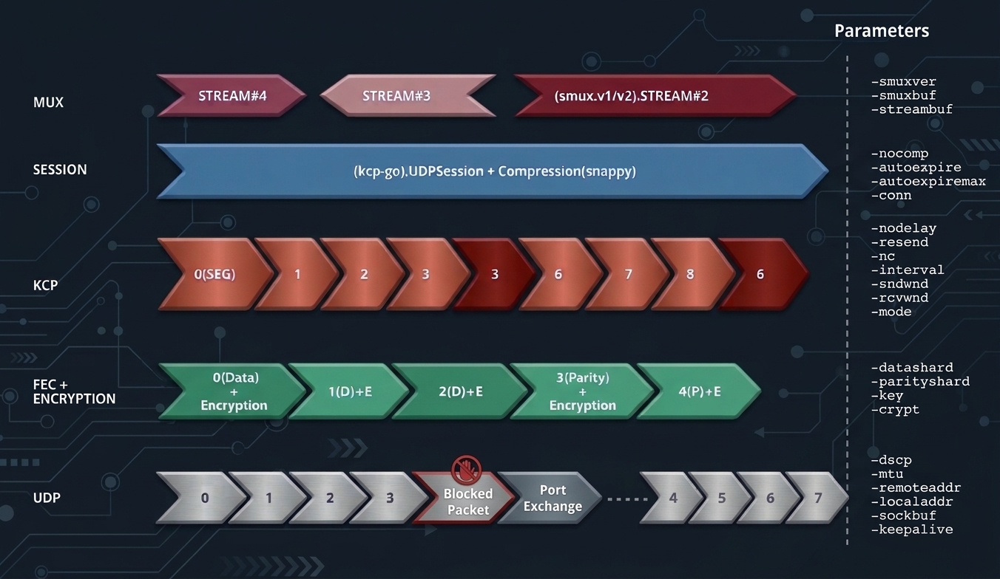

English | [简体中文](README.md)

# kcptun


A TCP-over-KCP tunnel: the client multiplexes local TCP connections onto KCP (UDP) toward the server, and the server converts them back to TCP and forwards them to the target service. It works well on lossy, high-latency links such as cross-border routes, weak mobile networks, and congested Wi-Fi.

- **Loss tolerance**: KCP ARQ + fast retransmit + Reed-Solomon FEC
- **Multiplexing**: smux carries many TCP streams over a single KCP session
- **Security**: pre-shared key plus optional encryption, compression, and QPP
- **Stability**: timed rotation keeps established connections alive, and the blockage-driven `autoexpire: -1` mode is the recommended upgrade



> Details such as manual setup, configuration examples, parameters, and differences from upstream are collapsed by default — click a section title to expand it.

## What Makes This Special Build Different

Upstream kcptun only rotates ports on a timer. This build adds a **blockage-driven** automatic mode: ports no longer rotate by clock, they all switch together only once a port is confirmed blocked. To enable it, write this into `client-config.json`:

```json
{
  "autoexpire": -1,
  "autoexpiremax": 0,
  "scavengettl": 0,
  "keepalive": 10,
  "keepalivetolerance": 2
}
```

- `autoexpire: -1` is the switch itself, any negative value enables the automatic mode
- Keep `autoexpiremax` and `scavengettl` at `0`; neither of them takes part in this mode
- `keepalive` and `keepalivetolerance` decide how fast a port is judged: it takes `keepalive × keepalivetolerance` seconds of silence before the port is suspected, and that product must stay below 30 (the session timeout built into smux). The default `10 × 2 = 20` seconds is fine
- The server has to run the same build with FEC enabled (`datashard` / `parityshard` above 0)

<details>
<summary><strong>Other ways to combine the three parameters</strong> (timed / randomized / disabled rotation)</summary>

### Other ways to combine the three parameters

`autoexpire` and `autoexpiremax` decide *when* to rotate, `scavengettl` decides *how* a retired session leaves:

| Configuration | Behaviour | When to use |
| --- | --- | --- |
| `autoexpire: 0` | No rotation, fixed port; `autoexpiremax` and `scavengettl` have no effect | The port is not targeted and you want the simplest setup |
| `autoexpire: N`, `autoexpiremax: 0` | Rotate every N seconds, fixed interval | Upstream behaviour |
| `autoexpire: N`, `autoexpiremax: M` (M > N) | Each connection expires randomly within `[N, M]` seconds | Keeps `conn` connections from switching in the same second |
| `autoexpire: -1` | Automatic mode: never rotates by clock, switches every port at once only when a port is confirmed blocked | Lossy links, QoS-throttled or port-targeted routes |

| `scavengettl` | Behaviour |
| --- | --- |
| `0` (default, recommended) | The old session lives until its TCP streams finish on their own, established connections are never cut |
| `N` | N seconds after retirement the session is force-closed even with unfinished streams, a safety net against long-lived retired sessions |

Three constraints:

- In the timed mode the retire pool holds `conn` sessions; when it is full the rotation is postponed until one drains (logged as `rotation deferred`), so the process never holds more than `2 × conn` sessions and resource usage stays bounded.
- `autoexpiremax` is ignored when it is not greater than `autoexpire`; `autoexpiremax` does nothing while `autoexpire` is `0` (a warning is printed).
- With `autoexpire: -1`, neither `autoexpiremax` nor `scavengettl` applies, and old sessions are closed instead of drained.

</details>

<details>
<summary><strong>Stability</strong>: from "one drop every 10 minutes" to "4–6 a day"</summary>

### Stability: From "One Drop Every 10 Minutes" to "4–6 a Day"

Timed rotation carries an unavoidable trade-off: upstream drops connections on every switch no matter how the traffic is scheduled, so the only way to drop less is to stretch the interval to 10 minutes – 1 hour. The longer the interval, the more likely a port is already blocked while the client waits for the next expiry — at the 3 hour extreme a blocked port can stay blocked for hours without ever rotating.

This build improves it in two steps: the timed mode retires sessions by draining them, so established connections no longer break just because a timer expired; and `autoexpire: -1` removes the clock altogether, leaving the number of switches to be decided purely by whether the route actually fails:

| Configuration | Average drop rate | Per day |
| --- | --- | --- |
| Timed rotation (previous best settings) | about once every 10 minutes | 1440 / 10 = **144 per day** |
| This build, `autoexpire: -1` | 4–6 times per 24 hours | **4–6 per day** |

That is a **24–36× reduction (roughly 96%–97%)** under normal conditions: an idle but healthy connection is never torn down just because its timer expired, and only a really poor environment (constant loss, a port repeatedly QoS-throttled) falls back toward the old numbers. Day-to-day operation needs no manual intervention, so the management burden is close to zero.

</details>

## One-Click Server Setup (Recommended)

The server can be installed with the [kcptun-script](https://github.com/TuuzNet/kcptun-script) installer, which handles downloads, configuration, process supervision, and firewall rules:

```sh
wget --no-check-certificate -O kcptun.sh https://github.com/TuuzNet/kcptun-script/raw/main/kcptun.sh
sh kcptun.sh
```

The script will:

- Download the server binary matching your CPU architecture from this repository's Releases
- Walk you through port, target, encryption, and mode settings (every prompt has a default, so you can just press Enter)
- Install Supervisor, enable start-on-boot, and restart the process automatically if it crashes
- Open the UDP port in firewalld / iptables automatically
- Print the matching **client JSON configuration** and a parameter string for mobile clients
- Support multiple instances, online updates, and installing a specific version

Common commands:

| Command | Description |
| --- | --- |
| `sh kcptun.sh` | Run the interactive installer |
| `sh kcptun.sh add` | Add another instance (multi-port) |
| `sh kcptun.sh reconfig 1` | Reconfigure instance 1 |
| `sh kcptun.sh show 1` | Show the configuration of instance 1 |
| `sh kcptun.sh log 1` | Show the log of instance 1 |
| `sh kcptun.sh del 1` | Delete instance 1 |
| `sh kcptun.sh update` | Check for script and kcptun updates |
| `sh kcptun.sh uninstall` | Uninstall |

> The script requires root, supports Debian/Ubuntu, CentOS/Fedora/RedHat and similar distributions, and only runs on x86 / x86_64.

<details>
<summary><strong>Manual Setup</strong> (download · start · background)</summary>

### Manual Setup

### 1. Download

Grab the files for your platform from [Releases](https://github.com/tobycroft/kcptun/releases):

| Platform | Client | Server |
| --- | --- | --- |
| Linux x86_64 | `client_linux_amd64` | `server_linux_amd64` |
| Linux x86 | `client_linux_386` | `server_linux_386` |
| Linux arm64 | `client_linux_arm64` | `server_linux_arm64` |
| Linux arm | `client_linux_arm` | `server_linux_arm` |
| macOS Intel / Apple Silicon | `client_darwin_amd64` / `client_darwin_arm64` | same as client |
| Windows x86_64 / x86 / arm64 | `client_windows_*.exe` | same as client |
| FreeBSD x86_64 | `client_freebsd_amd64` | `server_freebsd_amd64` |

Linux x86 / x86_64 also ship `kcptun-linux-*.tar.gz` archives (used by the installer, containing both client and server).

### 2. Start the Server

```sh
chmod +x server_linux_amd64
./server_linux_amd64 -c server-config.json
```

### 3. Start the Client

```sh
chmod +x client_linux_amd64
./client_linux_amd64 -c client-config.json
```

### 4. Use It

The client listens on `localaddr` (`:12948` by default). Point your application at that address, for example to accelerate SSH:

```sh
ssh -p 12948 user@127.0.0.1
```

Traffic path: local app → client `:12948` → KCP → server `:29900` → target `127.0.0.1:22`.

### 5. Run in the Background

For a quick test, run it in the foreground. For long-term use, prefer the **one-click script** above (Supervisor included). With a manual setup you can use systemd:

```ini
# /etc/systemd/system/kcptun.service
[Unit]
Description=kcptun server
After=network.target

[Service]
ExecStart=/usr/local/kcptun/server_linux_amd64 -c /usr/local/kcptun/server-config.json
Restart=always
RestartSec=3

[Install]
WantedBy=multi-user.target
```

```sh
systemctl daemon-reload && systemctl enable --now kcptun
```

</details>

<details>
<summary><strong>Configuration Examples</strong> (server-config.json / client-config.json)</summary>

### Configuration Examples

### Server: server-config.json

```json
{
  "listen": ":29900",
  "target": "127.0.0.1:22",
  "key": "very fast",
  "crypt": "aes",
  "mode": "fast",
  "mtu": 1350,
  "sndwnd": 1024,
  "rcvwnd": 1024,
  "datashard": 10,
  "parityshard": 3,
  "dscp": 0,
  "nocomp": true,
  "quiet": false,
  "tcp": false,
  "sockbuf": 67108864,
  "smuxbuf": 67108864,
  "streambuf": 16777216,
  "smuxver": 2,
  "keepalive": 10,
  "closewait": 30,
  "snmplog": "",
  "snmpperiod": 60,
  "pprof": false
}
```

### Client: client-config.json

```json
{
  "localaddr": ":12948",
  "remoteaddr": "vps.example.com:29900",
  "key": "very fast",
  "crypt": "aes",
  "mode": "fast",
  "mtu": 1350,
  "sndwnd": 1024,
  "rcvwnd": 1024,
  "datashard": 10,
  "parityshard": 3,
  "dscp": 0,
  "nocomp": true,
  "quiet": false,
  "tcp": false,
  "conn": 64,
  "autoexpire": 300,
  "autoexpiremax": 360,
  "scavengettl": 0,
  "sockbuf": 67108864,
  "smuxbuf": 67108864,
  "streambuf": 16777216,
  "smuxver": 2,
  "keepalive": 10,
  "keepalivetolerance": 2,
  "logsize": 1024,
  "closewait": 0,
  "snmplog": "",
  "snmpperiod": 60,
  "pprof": false
}
```

Notes:

- These values must match on both sides: `key`, `crypt`, `datashard`, `parityshard`, `mode` (or `nodelay/interval/resend/nc` in `manual` mode)
- Windows are mirrored: client `sndwnd` = server `rcvwnd`, and client `rcvwnd` = server `sndwnd`
- `autoexpire: 300` + `autoexpiremax: 360` rotates the local port every 300–360 seconds at random; set both to `0` to keep a fixed port
- `logsize: 1024` caps the client running log at 1 MB (the unit is KB): once full, the oldest whole lines are dropped so the file only keeps the most recent tail, still in chronological order and readable with `cat`/`tail`. It does not apply to `snmplog`, and the server has no such option
- `autoexpire: -1` is the fully automatic mode: ports never rotate by clock, they rotate together only once a port is confirmed blocked. A slot is judged blocked when nothing at all has arrived from the peer for `keepalive × keepalivetolerance` seconds **and** an out-of-band liveness probe stays unanswered. The probe is what tells a blocked path apart from an idle but healthy one, so an idle connection is never torn down. In this mode `autoexpiremax` and `scavengettl` do not apply, and the server has to run the same build (answering probes needs FEC, so `datashard`/`parityshard` must be above 0)

</details>

<details>
<summary><strong>Parameters</strong> (full server / client parameter tables)</summary>

### Parameters

### Server

| Parameter | Type | Default | Settable values | Description |
| --- | --- | --- | --- | --- |
| `listen` | string | `:29900` | any `IP:port` or `IP:minport-maxport` (port range) | Listen address; in range mode a port is picked at random per connection |
| `target` | string | `127.0.0.1:12948` | TCP address or Unix Socket path | Acceleration target |
| `key` | string | `it's a secrect` | any string (must match on both sides; also `KCPTUN_KEY` env var) | Pre-shared key |
| `crypt` | string | `aes` | `aes`, `aes-128`, `aes-192`, `salsa20`, `blowfish`, `twofish`, `cast5`, `3des`, `tea`, `xtea`, `xor`, `sm4`, `none`, `null` (must match) | Cipher; unknown values fall back to `aes` |
| `mode` | string | `fast` | `fast3` / `fast2` / `fast` / `normal` / `manual` | Mode preset; `manual` uses `nodelay` / `interval` / `resend` / `nc` |
| `mtu` | int | `1350` | `1000`–`1400` recommended | UDP packet MTU, avoid fragmentation |
| `sndwnd` / `rcvwnd` | int | `1024` | `≥1` (packets) | Send / receive window size |
| `datashard` / `parityshard` | int | `10` / `3` | `datashard + parityshard ≤ 255` (must match) | Reed-Solomon FEC data and parity shards; both must be `> 0` to enable the loss test |
| `dscp` | int | `0` | `0`–`63` (6 bits) | DSCP code point |
| `nocomp` | bool | `false` | `true` / `false` | Disable Snappy compression |
| `acknodelay` | bool | `false` | `true` / `false` | Flush ACK immediately on packet receipt (manual-related, hidden flag) |
| `nodelay` | int | `0` | `0` / `1` | KCP no-delay switch (manual mode, hidden flag) |
| `interval` | int | `50` | typical `10`–`60` (ms) | Internal retransmit interval (manual mode, hidden flag) |
| `resend` | int | `0` | `0` / `1` / `2` | Fast-retransmit count (manual mode, hidden flag) |
| `nc` | int | `0` | `0` / `1` | Congestion-control off switch (manual mode, hidden flag) |
| `sockbuf` | int | `4194304` | typically `4MB`–`64MB` (bytes) | Per-socket send/receive buffer |
| `smuxver` | int | `1` | `1` / `2` | smux version |
| `smuxbuf` | int | `4194304` | bytes | smux session-level buffer |
| `streambuf` | int | `2097152` | bytes | Per-stream receive buffer (smux v2+) |
| `keepalive` | int | `10` | `>0` (seconds) | Heartbeat interval |
| `closewait` | int | `30` | `≥0` (seconds) | Seconds to wait before tearing down a connection |
| `snmplog` / `snmpperiod` | string / int | `""` / `60` | file path (empty = off) / `>0` (seconds) | Traffic statistics file and collection period |
| `pprof` | bool | `false` | `true` / `false` | Enable profiling server on `:6060` |
| `log` | string | `""` | file path (empty = stderr) | Log file |
| `quiet` | bool | `false` | `true` / `false` | Suppress stream open/close logs |
| `tcp` | bool | `false` | `true` / `false` | Also listen on a TCP-emulated stack (Linux only) |
| `qpp` / `qpp-count` | bool / int | `false` / `61` | `true`/`false` / prime `≥8` | QPP quantum permutation pad toggle and pad count (more pads = safer, 256 bytes each, prime recommended) |

### Client

The client fully supports every transport parameter of the server (meaning in the table above, defaults in this table; note `sndwnd` defaults to `128` and `rcvwnd` to `512`, unlike the server's `1024`). The table below lists every parameter: transport parameters only show their default and settable values, while client-only parameters are fully described.

| Parameter | Type | Default | Settable values | Description |
| --- | --- | --- | --- | --- |
| `localaddr` | string | `:12948` | any `IP:port` or Unix Socket path (no `:` means socket path) | Local listen address |
| `remoteaddr` | string | `vps:29900` | `IP:port` or `IP:minport-maxport` (range, picked at random per dial) | Server address |
| `conn` | int | `1` | `≥1` | Number of KCP connections to the server; local connections assigned round-robin |
| `autoexpire` | int | `0` | `0` (off) / `-1` (blockage-driven) / `N>0` (seconds, lower bound of `autoexpiremax`) | Port rotation interval |
| `autoexpiremax` | int | `0` | `0` (fixed) / `M>autoexpire` (random upper bound, seconds) | Random upper bound of rotation; unused in `-1` mode |
| `scavengettl` | int | `0` | `0` (never force close, recommended) / `N>0` (seconds) | Force-close deadline for retired connections; unused in `-1` mode |
| `keepalivetolerance` | int | `2` | `≥1`, and `keepalive × keepalivetolerance < 30` | Consecutive unanswered heartbeats tolerated before a port is judged blocked; only used with `autoexpire: -1` |
| `logsize` | int | `0` | `0` (unlimited) / `N>0` (KB) | Size cap for the running log file; oldest lines dropped when full; only applies to `-log`, no such option on the server |
| `closewait` | int | `0` | `≥0` (seconds) | Seconds to wait before tearing down a connection (server default is `30`) |
| `key` | string | `it's a secrect` | same as server | Pre-shared key |
| `crypt` | string | `aes` | same as server | Cipher |
| `mode` | string | `fast` | same as server | Mode preset |
| `mtu` | int | `1350` | `1000`–`1400` recommended | UDP MTU |
| `sndwnd` | int | `128` | `≥1` (packets) | Send window (default differs from server) |
| `rcvwnd` | int | `512` | `≥1` (packets) | Receive window (default differs from server) |
| `datashard` | int | `10` | `datashard + parityshard ≤ 255` | FEC data shards |
| `parityshard` | int | `3` | same as above | FEC parity shards |
| `dscp` | int | `0` | `0`–`63` | DSCP |
| `nocomp` | bool | `false` | `true`/`false` | Disable compression |
| `acknodelay` | bool | `false` | `true`/`false` | Flush ACK immediately (manual-related) |
| `nodelay` | int | `0` | `0`/`1` | No-delay switch (manual) |
| `interval` | int | `50` | `10`–`60` (ms) | Retransmit interval (manual) |
| `resend` | int | `0` | `0`/`1`/`2` | Fast retransmit (manual) |
| `nc` | int | `0` | `0`/`1` | Congestion-control off (manual) |
| `sockbuf` | int | `4194304` | typically `4MB`–`64MB` (bytes) | Socket buffer |
| `smuxver` | int | `1` | `1`/`2` | smux version |
| `smuxbuf` | int | `4194304` | bytes | smux session buffer |
| `streambuf` | int | `2097152` | bytes | smux per-stream buffer |
| `keepalive` | int | `10` | `>0` (seconds) | Heartbeat interval |
| `log` | string | `""` | file path (empty = stderr) | Log file |
| `snmplog` / `snmpperiod` | string / int | `""` / `60` | file path (empty = off) / `>0` (seconds) | Traffic statistics |
| `quiet` | bool | `false` | `true`/`false` | Suppress stream logs |
| `tcp` | bool | `false` | `true`/`false` | TCP emulation (Linux only) |
| `pprof` | bool | `false` | `true`/`false` | Profiling |
| `qpp` / `qpp-count` | bool / int | `false` / `61` | same as server | QPP pads |

> Client-only parameters and default differences: besides `localaddr` / `remoteaddr` / `conn` / `autoexpire` / `autoexpiremax` / `scavengettl` / `keepalivetolerance` / `logsize`, the client defaults for `sndwnd` (128), `rcvwnd` (512) and `closewait` (0) differ from the server. Loss-test parameters (`losstest` and friends) are in the "Loss Test · Parameters" section below.

</details>

## Loss Test

The client has a built-in loss test mode based on KCP OOB probes, answering the question "does this link actually drop packets, and how stable is the latency?"

<details>
<summary><strong>Loss Test</strong> · Principle</summary>

### Loss Test · Principle

KCP's reliable transport retransmits lost packets, so you never see loss in the application stream; `ping`/`mtr` test ICMP, but many ISPs treat ICMP and UDP differently. The loss test uses kcp-go's OOB (out-of-band) channel:

- OOB packets are **not retransmitted, not reordered, not ACKed** — behaving exactly like raw UDP probes;
- Probe packets reuse the KCP session's encryption, port, MTU, and FEC parameters, traversing the same UDP path as proxy traffic;
- The test runs in two sequential phases: **downlink first** (server sends probes, client counts received sequence numbers), **then uplink** (client sends probes, server counts received packets and reports via a control packet); loss rates for the two directions are independent;
- Uplink probe packets are echoed back by the server so the client can calculate RTT and jitter.

This means the test measures "the true performance of the UDP path that the KCP session uses" without being masked by retransmissions.

</details>

<details>
<summary><strong>Loss Test</strong> · Prerequisites</summary>

### Loss Test · Prerequisites

| Condition | Description |
| --- | --- |
| Version | Both server and client must be `losstest`-capable builds of the same version |
| FEC | Must be enabled; both `datashard` and `parityshard` greater than 0 |
| Client | CLI client required; mobile apps do not support this yet |
| Port | Same as the server listen port; no additional firewall rules needed |

The server requires no extra configuration — newer versions automatically register the loss test handler on every KCP session and only respond to marked OOB packets.

</details>

<details>
<summary><strong>Loss Test</strong> · Usage and Output Example</summary>

### Loss Test · Usage and Output Example

Client command (transport parameters must match the server):

```sh
./client -losstest -losstest-duration 30 -losstest-rate mid \
  -remoteaddr SERVER:29900 -key 'your key' -crypt aes \
  -datashard 10 -parityshard 3 -mtu 1350 -nocomp
```

You can also use the command generated by the one-click script (recommended, auto-aligns instance parameters):

```sh
sh kcptun.sh losstest [id]
```

Output after the test:

```
==================== KCPTUN LOSS TEST ====================
target        : 203.0.113.5:29900
local         : 192.0.2.10:54321
rate          : mid (1000 pps)
payload       : 64 bytes
duration      : 30s per direction
----------------------------------------------------------
phase 1       : downlink (server -> client)
sent          : 29986 packets (by server)
received      : 29742 packets (at client)
lost          : 244 packets (0.814%)
----------------------------------------------------------
phase 2       : uplink (client -> server)
sent          : 29991 packets (by client)
received      : 29768 packets (at server)
lost          : 223 packets (0.744%)
rtt (echo)    : min 18.20ms / avg 25.40ms / p50 24.00ms / p95 41.00ms / p99 60.00ms / max 120.30ms
jitter        : 3.20ms
actual rate   : 999 pps over 30s
send errors   : 0
==========================================================
```

</details>

<details>
<summary><strong>Loss Test</strong> · Parameters</summary>

### Loss Test · Parameters

| Parameter | Default | Description |
| --- | --- | --- |
| `losstest` | `false` | Enter one-shot test mode; no local port is opened |
| `losstest-duration` | `30` | Test duration in seconds (1–300) |
| `losstest-rate` | `mid` | `low` = 100 pps, `mid` = 1000 pps, `full` ≈ 20000 pps |
| `losstest-size` | `64` | OOB probe packet size in bytes (32–1024) |
| `losstest-pps` | `20000` | Rate cap for `full`; lower it to reduce impact on live traffic |

</details>

<details>
<summary><strong>Loss Test</strong> · Rate Tiers and Environment Applicability</summary>

### Loss Test · Rate Tiers and Environment Applicability

| Tier | Rate | Extra Traffic | Suitable Environment | Suggested Duration |
| --- | --- | --- | --- | --- |
| Low `low` | 100 pps | ≈0.1 Mbps | Home broadband, mobile networks, high-latency cross-border routes; can run alongside live traffic | 60 s |
| Mid `mid` | 1000 pps | ≈1 Mbps | Typical VPS / home broadband; assess everyday link quality | 15–30 s |
| Full `full` | 20000 pps | ≈20 Mbps | High-bandwidth VPS, dedicated lines, gigabit broadband; diagnose "fine when idle, lossy under load" | 15 s, avoid peak hours |

Duration guidelines:

- **15 s**: quick connectivity and rough loss check;
- **30 s**: standard test, suitable for `mid`;
- **60 s**: observe stability and jitter; recommended for `low` to improve loss-rate confidence.

Use cases:

- `ping`/`mtr` look fine but the proxy still stalls with visible retransmissions — ICMP and UDP may take different paths; use OOB to measure the real UDP link;
- Suspect ISP UDP throttling / QoS — run all three tiers in the same time window: low is fine but full shows increasing loss means bandwidth or QoS limits; all three lose packets means the link itself is faulty;
- Cross-border route with time-dependent jitter — run 60 s on `low` during the problematic window, focus on RTT p95 and jitter;
- Before/after FEC tuning — use the same tier and duration as a baseline comparison.

</details>

<details>
<summary><strong>Loss Test</strong> · Interpreting Results</summary>

### Loss Test · Interpreting Results

| Metric | Guidance |
| --- | --- |
| Loss < 0.1% | Excellent |
| 0.1%–1% | Usable; KCP retransmissions can absorb this, FEC 1–3 shards sufficient |
| 1%–3% | Perceptible; consider raising `parityshard` (4–6) and investigate the route |
| > 3% | Clearly impacts experience; prioritize checking the route, UDP QoS, or congestion |
| RTT p95 far above min | Queuing/jitter present; watch for bufferbloat or link congestion |
| Jitter persistently high | Unstable link (mobile network, cross-border congestion) |
| Near 100% loss | Server not updated, FEC not enabled, port unreachable, or UDP blocked |

</details>

<details>
<summary><strong>Loss Test</strong> · Limitations</summary>

### Loss Test · Limitations

- Uplink and downlink are measured separately: downlink is counted at the client, uplink is reported by the server; total test time is roughly twice the per-direction duration;
- OOB probes are intentionally **not** FEC-protected — only by bypassing correction and retransmission can the true path loss be observed;
- `full` tier caps at 20000 pps by default to avoid sender queue silent drops polluting results; lower `-losstest-pps` on weak hardware or limited bandwidth;
- Mobile client does not support this test yet.

</details>

<details>
<summary><strong>Differences from Upstream kcptun</strong></summary>

### Differences from Upstream kcptun

1. **New `autoexpiremax`**: the rotation time is randomized within `[autoexpire, autoexpiremax]` seconds, so connections do not all switch at once.
2. **Rotation no longer drops connections**: after expiry, new connections use the new port while existing ones keep running on the old session until they finish naturally.
3. **`scavengettl` defaults to 0**: sessions with live connections are never force-closed unless you explicitly set a deadline.
4. **Bounded resources and cleaner logs**: at most `conn` retired sessions are kept (total ≤ `2 × conn`), and normal teardown no longer prints `use of closed network connection`.
5. **New `autoexpire: -1` mode and `keepalivetolerance`**: rotation is no longer clock driven, port blockage is detected from heartbeat silence plus an out-of-band liveness probe, and once confirmed every port switches at once. This also sidesteps a known side effect of timed rotation: the server (kcp-go `Listener`) maps sessions by client address rather than by `conv`, so an old session and its replacement fight over the same address slot, which shows up as the first connection after a rotation failing only after a 30 second timeout while the second one succeeds. The automatic mode never leaves two sessions running side by side, so the race cannot happen.
6. **New `logsize` (client only)**: a KB-sized cap on the file given to `-log`. Past the cap the oldest whole lines are dropped and only the recent tail is kept, so the file never exceeds the limit while staying in order. `0` keeps the legacy append-forever behaviour, and the server has no such option.

</details>

<details>
<summary><strong>Build from Source</strong></summary>

### Build from Source

```sh
go build -o client/client ./client
go build -o server/server ./server
```

Requires Go 1.27+.

Verify the multi-platform artifacts locally (identical matrix and naming to the published
Release assets):

```sh
VERSION=v20261030.1 bash .github/scripts/build-dist.sh
```

</details>

<details>
<summary><strong>Automation Pipeline</strong></summary>

### Automation Pipeline

Third-party dependency updates (Dependabot) → CI (`gofmt` / `go vet` / build / tests) →
auto-merge (squash) → multi-platform build + SHA-256 checksums → automatic tag and GitHub
Release are fully handled by GitHub Actions. Once a dependency update lands on `master`,
the new binaries are published with no manual step, using the same file names as the table
above.

See [`.github/AUTOMATION.md`](.github/AUTOMATION.md) for the full flow, required repository
settings, first-run verification steps and troubleshooting.

</details>

## Acknowledgements

This project is derived from [xtaci/kcptun](https://github.com/xtaci/kcptun). Thanks to the original author **xtaci** for the excellent work, and to the underlying libraries [kcp-go](https://github.com/xtaci/kcp-go), [smux](https://github.com/xtaci/smux), [qpp](https://github.com/xtaci/qpp) and [tcpraw](https://github.com/xtaci/tcpraw).

## License

MIT License